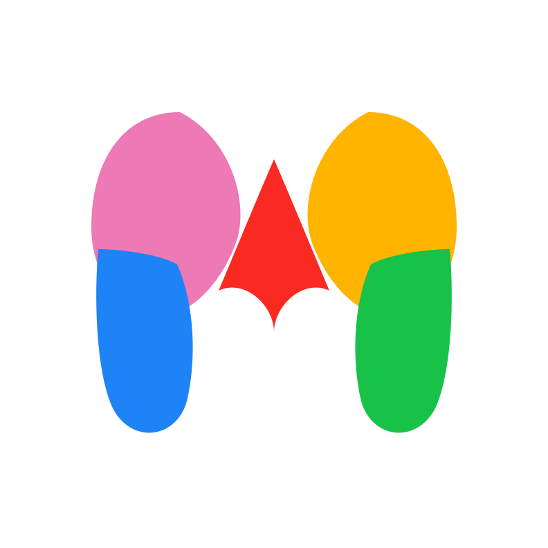

<p align="center"> 
  <br/>
  <a href="https://opensource.org/license/agpl-v3"></a>
  <a href="https://github.com/SirEntr0pyy/immiguel/actions/workflows/build-immiguel.yml">
    
  </a>
  <a href="https://github.com/SirEntr0pyy/immiguel/pkgs/container/immiguel-server">
    
  </a>
  <br/>
  <br/>
</p>

<p align="center">
  <a href="#">
    
  </a>
</p>
<h1 align="center">Immiguel</h1>
<h3 align="center">High performance self-hosted photo and video management solution with native chunked uploads</h3>
<br/>
<a href="https://immich.app">

</a>
<br/>

> [!NOTE]
> **Immiguel** is a dedicated fork of [Immich](https://github.com/immich-app/immich) built to seamlessly bypass Cloudflare Free's 100&nbsp;MB reverse-proxy request limit via native **chunked uploads (50&nbsp;MB chunks)** across Server, Web, and Android.

> [!IMPORTANT]
> - **Chunked Uploads**: Files larger than 50&nbsp;MB are sliced and uploaded incrementally with pause/resume capabilities, preventing `HTTP 413 (Payload Too Large)` errors behind Cloudflare.
> - **Android Focused**: iOS support and related dependencies have been cleanly removed to streamline builds and maintenance.
> - **Ready-to-use Docker Image**: Available at `ghcr.io/sirentr0pyy/immiguel-server:latest`.
> - **Release APK**: Built automatically and published as an artifact in GitHub Actions (`immiguel.apk`).

> [!WARNING]
> ⚠️ Always follow the [3-2-1](https://www.backblaze.com/blog/the-3-2-1-backup-strategy/) backup plan for your precious photos and videos!

## Quick Start (Docker Compose)

Running Immiguel is a drop-in replacement for standard Immich:

```yaml
services:
  immiguel-server:
    container_name: immiguel_server
    image: ghcr.io/sirentr0pyy/immiguel-server:latest
    volumes:
      - ${UPLOAD_LOCATION}:/usr/src/app/upload
      - /etc/localtime:/etc/localtime:ro
    env_file:
      - .env
    ports:
      - '2283:2283'
    depends_on:
      - redis
      - database
    restart: always

  immiguel-machine-learning:
    container_name: immiguel_machine_learning
    image: ghcr.io/immich-app/immich-machine-learning:${IMMICH_VERSION:-release}
    volumes:
      - model-cache:/cache
    restart: always
```

See [docker/docker-compose.yml](docker/docker-compose.yml) and [docker/docker-compose.prod.yml](docker/docker-compose.prod.yml) for full deployment configurations.

## Features

| Features                                     | Mobile (Android) | Web |
| :------------------------------------------- | :--------------: | :-: |
| **Chunked File Upload (bypasses 100 MB proxy limits)** | **Yes (50 MB chunks)** | **Yes (50 MB chunks)** |
| Upload and view videos and photos            | Yes              | Yes |
| Auto backup when the app is opened           | Yes              | N/A |
| Prevent duplication of assets                | Yes              | Yes |
| Selective album(s) for backup                | Yes              | N/A |
| Download photos and videos to local device   | Yes              | Yes |
| Multi-user support                           | Yes              | Yes |
| Album and Shared albums                      | Yes              | Yes |
| Scrubbable/draggable scrollbar               | Yes              | Yes |
| Support raw formats                          | Yes              | Yes |
| Metadata view (EXIF, map)                    | Yes              | Yes |
| Search by metadata, objects, faces, and CLIP | Yes              | Yes |
| Administrative functions (user management)   | No               | Yes |
| Background backup                            | Yes              | N/A |
| Virtual scroll                               | Yes              | Yes |
| OAuth support                                | Yes              | Yes |
| API Keys                                     | N/A              | Yes |
| LivePhoto/MotionPhoto backup and playback    | Yes              | Yes |
| Support 360 degree image display             | No               | Yes |
| User-defined storage structure               | Yes              | Yes |
| Public Sharing                               | Yes              | Yes |
| Archive and Favorites                        | Yes              | Yes |
| Global Map                                   | Yes              | Yes |
| Partner Sharing                              | Yes              | Yes |
| Facial recognition and clustering            | Yes              | Yes |
| Memories (x years ago)                       | Yes              | Yes |
| Offline support                              | Yes              | No  |
| Read-only gallery                            | Yes              | Yes |
| Stacked Photos                               | Yes              | Yes |
| Tags                                         | No               | Yes |
| Folder View                                  | Yes              | Yes |

## Upstream Links & Documentation

- [Immich Documentation](https://docs.immich.app/)
- [Immich Introduction](https://docs.immich.app/overview/introduction)
- [Immich Requirements](https://docs.immich.app/install/requirements)
- [Upstream Repository](https://github.com/immich-app/immich)
